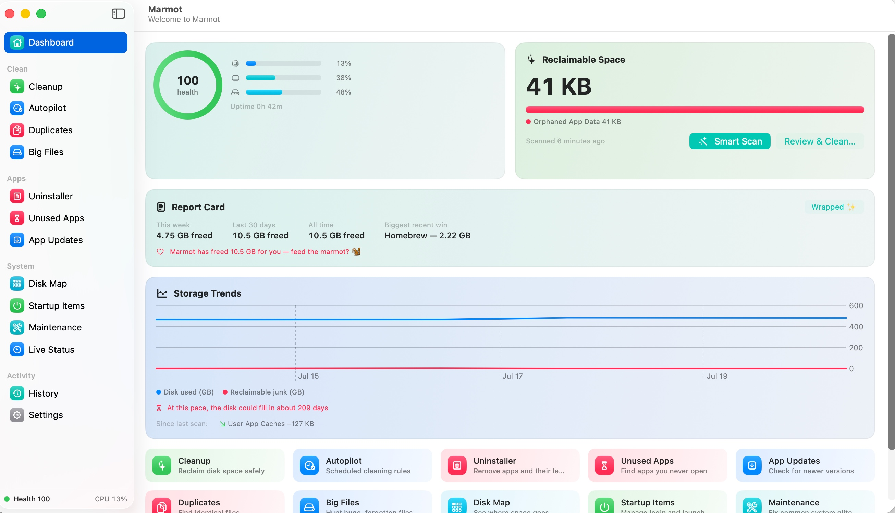
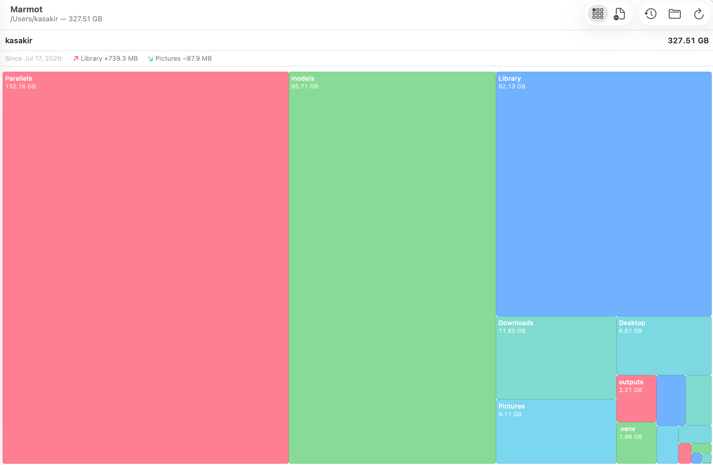
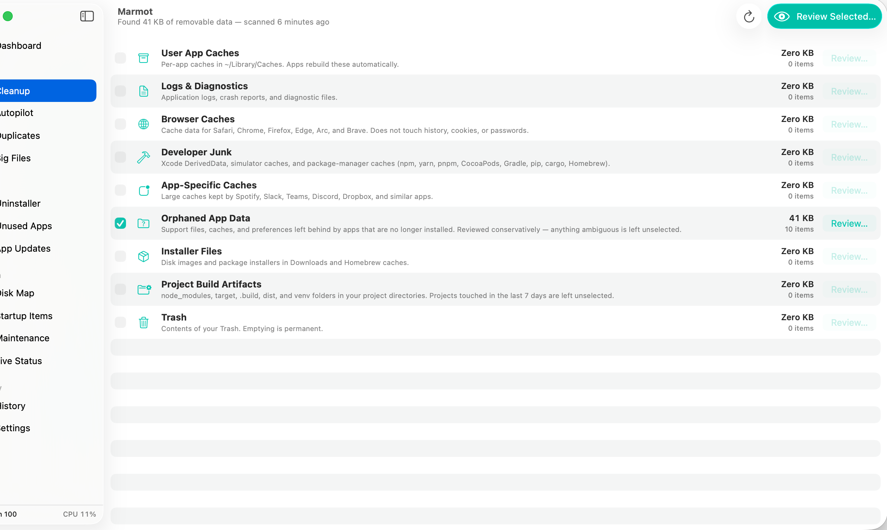
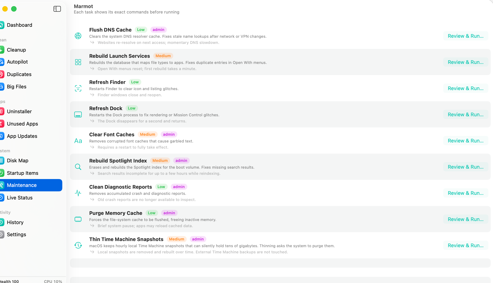
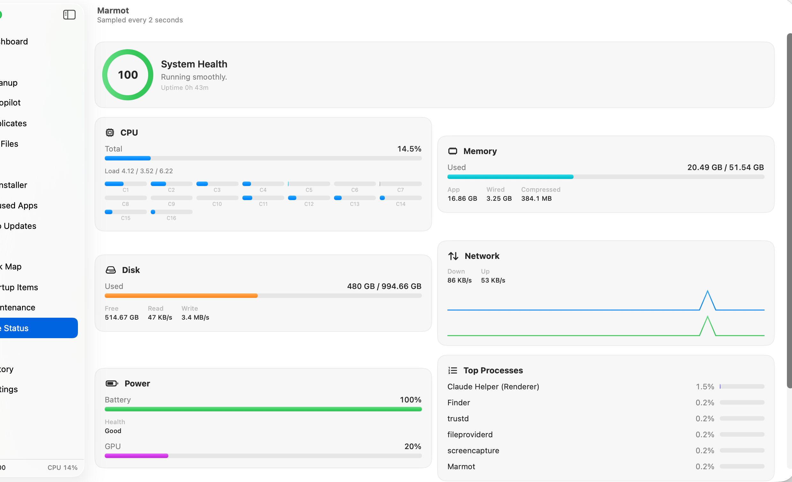

# 🐿️ Marmot

**A free, open-source Mac cleaner that shows you everything before it touches anything.**

Marmot cleans, uninstalls, automates, analyzes, watches, and monitors your Mac — fifteen tools in one lightweight native app, built for macOS 26 with **Liquid Glass** and dressed in friendly pastels (five switchable color themes). Think CleanMyMac + AppCleaner + DaisyDisk + iStat Menus + MacUpdater, except it's free, MIT-licensed, self-updating, and *obsessively* transparent about what it's doing. 💛

Inspired by the wonderful [Mole CLI](https://github.com/tw93/mole), rebuilt from scratch in Swift/SwiftUI.



<p align="center">
  
  
</p>
<p align="center">
  
  
</p>

---

## 📦 Install

**Requires macOS 26 (Tahoe) or later.**

**Homebrew** (recommended):

```sh
brew install --cask EPeiffer94/marmot/marmot
```

**Or manually:** grab the latest `Marmot-x.x.x.zip` from the [**Releases page**](https://github.com/EPeiffer94/Marmot/releases), unzip, and drag **Marmot.app** into **Applications**.

Either way, from then on Marmot updates itself — signed, verified, one click.

> 🕰️ **On macOS 13–15?** [Marmot 3.2.0](https://github.com/EPeiffer94/Marmot/releases/tag/v3.2.0) is the final release for you, and it's a complete, safe, fully-featured app — every tool described below except the Liquid Glass coat of paint. Marmot won't offer you an update it can't run.

**First launch only:** Marmot is free community software, not notarized through Apple's paid program, so macOS balks once. Double-click Marmot → click **OK** (not "Move to Trash"!) → **System Settings → Privacy & Security → "Open Anyway"** → confirm. That's the whole dance, forever. 💃

<details>
<summary>Terminal alternative (one line)</summary>

```sh
xattr -cr /Applications/Marmot.app && open /Applications/Marmot.app
```
</details>

---

## ✨ The big idea: look before you leap

Most cleaner apps ask for your trust. Marmot shows its work instead. 👀

Every destructive action goes through a **Change Plan**:

1. 📋 **Review** — every file, folder, and command in a visual list with sizes, risk badges (🟢🟠🔴), and plain-English explanations
2. 👁️ **Dry run** — simulate the whole plan; nothing on disk is touched, you get a full "would have happened" report
3. ✅ **Apply** — only after a confirmation that spells out the consequences

And even then: removals are **trash-first** (recoverable — and restorable straight from the History tab), every path is **re-validated at deletion time** against protected zones (Documents, Photos, Mail, backups… always off-limits), and everything is **logged**. Right-click any item in a preview to reveal it in Finder or mark it *Never Touch This*.

---

## ⚖️ How Marmot compares

| | 🐿️ **Marmot** | CleanMyMac | AppCleaner | DaisyDisk |
|---|:---:|:---:|:---:|:---:|
| **Price** | Free forever | Paid (subscription or one-time) | Free | Paid (one-time) |
| **Open source** | ✅ MIT | ❌ | ❌ | ❌ |
| **Dry-run rehearsal** (simulate first, touch nothing) | ✅ | ❌ | ❌ | ❌ |
| **One-click Undo** + restore from History | ✅ | ❌ | ❌ | ❌ |
| **Uninstaller** with leftover hunting | ✅ | ✅ | ✅ | ❌ |
| **Duplicate finder** (hash-verified) | ✅ | ❌ ¹ | ❌ | ❌ |
| **Big-file hunter** | ✅ | ✅ | ❌ | ✅ |
| **Disk treemap** | ✅ | ✅ | ❌ | ✅ |
| **Disk Time Travel** (scrub folder history) | ✅ | ❌ | ❌ | ❌ |
| **New-startup-item alerts** (the day something installs itself) | ✅ | ❌ | ❌ | ❌ |
| **Explainable health score** (shows every factor and its cost) | ✅ | ❌ | ❌ | ❌ |
| **Scheduled auto-clean rules** | ✅ | ❌ | ❌ | ❌ |
| **App update checker** (brew + Sparkle + App Store) | ✅ | ✅ | ❌ | ❌ |
| **Menu bar system monitor** | ✅ | ✅ | ❌ | ❌ |

¹ Sold separately as a second paid app.

*Based on publicly listed features as of August 2026 — competitors evolve, and each is good at what it does. Spotted an error? PRs welcome.*

---

## 🪟 Looks the part

Marmot 4.0 is built for macOS 26. The floating layer — the ⌘K command palette, the drag-to-uninstall target, the freed-space toast — renders in **Liquid Glass**, with toolbars, sidebar, and sheets picking up the system material. Applied deliberately, not everywhere: glass belongs to the controls layer, so data tables and dashboard cards keep solid, readable surfaces.

Then make it yours — **five color themes** in Settings, each a coordinated set of pastels spread across the tools rather than a single flat tint:

🎨 **Classic** (mint · green · pink · blue) · 🌊 **Ocean** · 🍬 **Bubblegum** · 🌿 **Meadow** · 🍧 **Sorbet**

Risk badges and health colors never change with the theme — those mean something.

---

## 🧰 What's inside

**🏠 Dashboard** — system health, reclaimable space with one-button **Smart Scan**, storage trends with a fill-up forecast, a suggestions feed that connects the dots ("12 GB of developer junk", "3 apps untouched for a year"), and **Marmot Wrapped** ✨ — a shareable card of your cleaning stats. Press **⌘K** anywhere for the command palette (it understands "uninstall slack" and "files over 2gb"), **⌘1–9** to jump between tools; Marmot reopens wherever you left off.

### Clean

| | | |
|---|---|---|
| ✨ | **Cleanup** | Caches, logs, browser junk, developer clutter, app caches, leftovers from deleted apps, old installers, stale `node_modules` |
| ⏱️ | **Autopilot** | Write cleaning rules once — *"browser caches weekly"* — and Marmot runs them on schedule, trash-first, logged, announced |
| 🪞 | **Duplicates** | Identical-content files (hash-verified, hardlink-aware); you pick the keeper |
| 🔍 | **Big Files** | Every file over 100 MB in your home folder, filterable by size and age — find the forgotten 4 GB screen recording |

### Apps

| | | |
|---|---|---|
| 🗑️ | **Uninstaller** | App + all its hidden friends: launch agents, preferences, containers, caches. **Drag any app onto the window or Dock icon** to jump straight to its removal preview. **Reset** clears an app's data without uninstalling; **Time Capsule** archives everything to a zip first, making uninstalls reversible forever |
| ⏳ | **Unused Apps** | Apps unopened for 3/6/12 months (real Spotlight data) with their footprint |
| ⬇️ | **App Updates** | Outdated apps via Homebrew, Sparkle feeds, and the App Store — plus **Watchtower**, which checks in the background and notifies you |

### System

| | | |
|---|---|---|
| 🗺️ | **Disk Map** | Clickable treemap colored by file type, "since last scan: Movies +12 GB" folder diffing, and **Disk Time Travel** ⏪ — scrub a timeline and watch the map morph as folders grew and shrank |
| ⚡ | **Startup Items** | Every login item, agent, and daemon in plain English — plus **Startup Sentinel** 🗼, which notifies you the day something new starts launching at boot |
| 🔧 | **Maintenance** | Flush DNS, rebuild Spotlight, thin Time Machine snapshots… each task shows its *exact commands* first |
| 📊 | **Live Status** | Per-core CPU, GPU, memory, disk I/O, network graphs, battery health — plus a built-in **internet speed test** |
| 🎛️ | **Menu bar HUD** | Live CPU% up top; click for a mini dashboard with Smart Scan, junk alerts, and what you freed this week |
| 🕰️ | **History** | Every change and dry run, filterable — with one-click **Restore** from the Trash |

**📊 Live Status** deserves its own note: the health score isn't a number Marmot asks you to trust. It shows its **receipt** — every factor (CPU, memory pressure, disk space, thermal state, battery) with its live reading and the exact points it's costing. Rolling sparklines, and an optional notification when health drops below your threshold.

> 💡 Several of these — App Reset, background update watching, new-startup-item alerts, scheduled cleaning, time-capsule uninstalls — are paid features elsewhere. Here they're just… features.

---

## 🧭 Your first five minutes

1. **Dashboard → Smart Scan** — see what's reclaimable, with a colorful breakdown
2. **Review Selected…** in Cleanup — uncheck anything, hit **Dry Run** for a zero-risk rehearsal, then apply. Files land in the Trash, and History can restore them
3. **Big Files** — one scan, sort by size, gasp
4. Grant **Full Disk Access** when you're ready (System Settings → Privacy & Security): one-time, and it lets the scanners see protected corners like Mail and other apps' containers. Without it nothing breaks — those spots are just skipped

---

## 🛡️ Safety, in plain words

- There is **no code path around the preview**. None. 🙅
- High-risk items are never pre-checked; risky categories aren't even eligible for Autopilot
- Admin-needing tasks are labeled `admin` and use the standard macOS password prompt
- Your own no-go folders: **Settings → Protected Paths**
- Marmot **never runs as root**, and never phones home — the only network calls are the ones you ask for (update checks, speed test)
- Hostile filenames can't break out: every path spliced into a shell command goes through strict POSIX quoting, and the safety gate is hammered by a hostile-path test suite on every change. The full threat model lives in [SECURITY.md](SECURITY.md)
- Still nervous? Dry Run everything, forever. Totally valid lifestyle. 💙

---

## 🔄 Self-updates

Since 2.1.0, Marmot updates itself via [Sparkle](https://sparkle-project.org): it checks this repo's appcast and cryptographically verifies every update against the project's EdDSA key before installing.

<details>
<summary>Release process (maintainers)</summary>

```sh
make release VERSION=x.y.z
sh scripts/make-appcast-entry.sh Marmot-x.y.z.zip x.y.z   # sign + appcast
sh scripts/make-cask.sh                                   # refresh Homebrew cask
git add -A && git commit -m "Release x.y.z" && git push
git tag vx.y.z && git push origin vx.y.z
# create the GitHub release, attach the zip (exact filename), then:
cp packaging/homebrew/marmot.rb ../homebrew-marmot/Casks/marmot.rb
cd ../homebrew-marmot && git commit -am "marmot x.y.z" && git push
```

The signing key lives in the maintainer's Keychain — keep an exported backup safe. Existing users update via Sparkle regardless; the cask copy keeps *fresh* `brew` installs on the newest version.
</details>

---

## 🚀 Building from source

macOS 26+ and **full Xcode 26** (free from the App Store — no paid developer account needed):

```sh
git clone https://github.com/EPeiffer94/Marmot.git
cd Marmot
make run
```

> ⚠️ **Command Line Tools alone are not enough.** Modern SwiftUI implements `@State` and friends as macros, and the macro plugins ship only with full Xcode. A CLT-only machine fails with `external macro implementation type 'SwiftUIMacros.StateMacro' could not be found`. If you have Xcode installed but still hit it, point the toolchain at it:
> ```sh
> sudo xcode-select -s /Applications/Xcode.app/Contents/Developer
> ```

```
Sources/Marmot/
  Models/ChangePlan.swift  The preview-first core
  Engine/                  Scanners, safety gate, executor, autopilot, stats
  Views/                   SwiftUI — one file per tool + shared components
```

Read `Engine/SafetyRules.swift` first — it's the constitution everything else obeys. CI runs build + tests + SwiftLint on every push.

> 💡 Hitting *"unable to type-check this expression in reasonable time"* in a view? It's almost never the line the compiler blames — it's the whole `body` chain. Split `body` into stages and pull closure bodies into named methods (`MainWindow.swift` shows the pattern).

---

## 🤝 Contributing

PRs and issues welcome — [CONTRIBUTING.md](CONTRIBUTING.md) has setup, architecture, and the preview-first ground rule. Easy first wins: new app-cache definitions (one line!), treemap colors, translations 🌍 (copy `Resources/en.lproj` to your language and follow the instructions inside).

## 💛 Support Marmot

Free forever — no upsells, no license keys, staying that way. If Marmot saved you gigabytes: ⭐ star the repo, [buy a coffee on Ko-fi](https://ko-fi.com/kasakir), [sponsor on GitHub](https://github.com/sponsors/EPeiffer94), or tell a friend with a full disk. Tip jar's in the app too: **Settings → Support**.

## 📜 License

MIT. 🎁 Not affiliated with Mole or mole.fit — feature inspiration lovingly credited to [tw93/Mole](https://github.com/tw93/mole).
