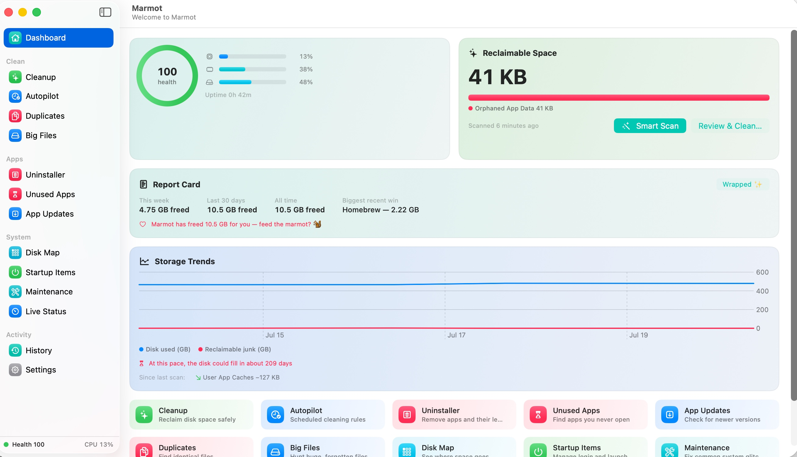
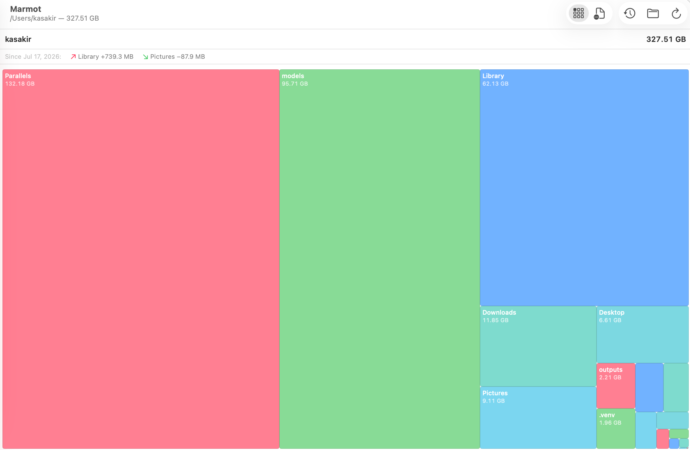
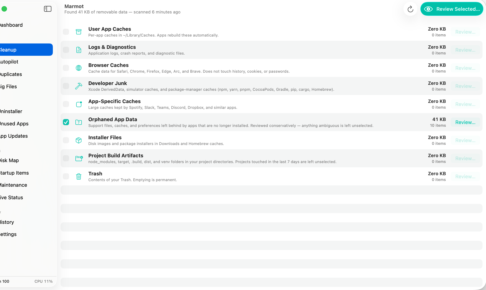
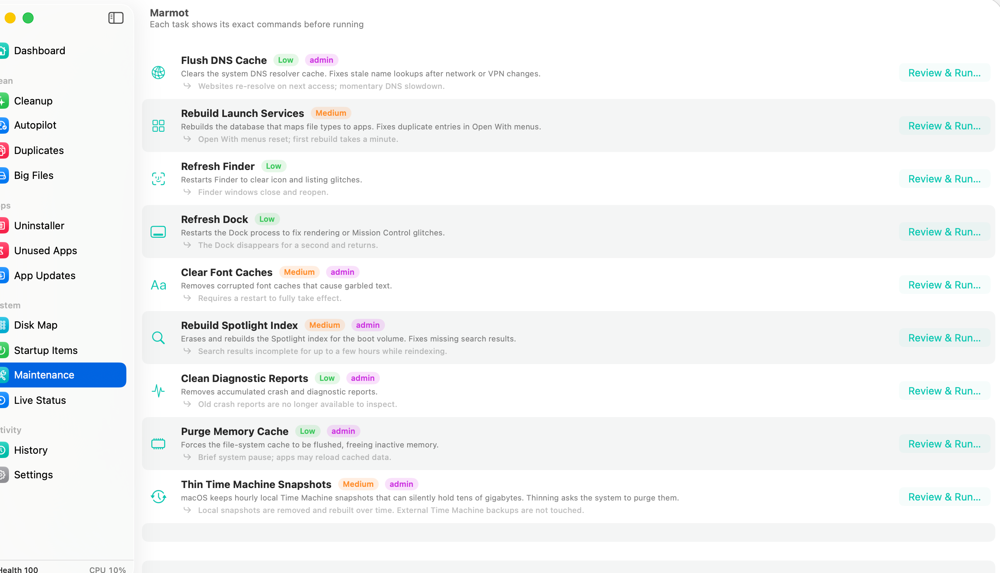
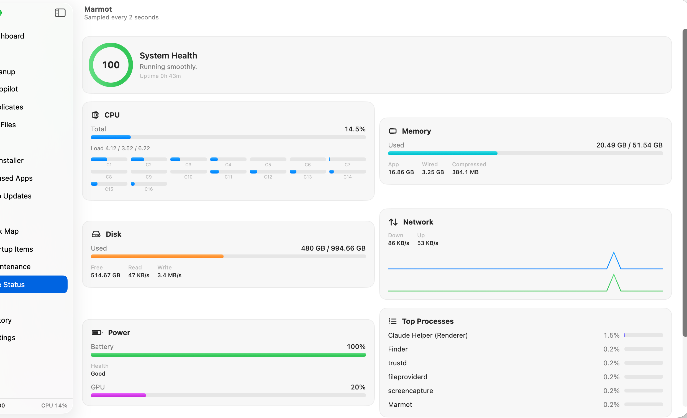

# Marmot

A free, open-source Mac cleaner that shows you exactly what it will change before it changes anything.

Marmot cleans caches and junk, uninstalls apps along with their leftovers, finds duplicates and big files, maps your disk, and monitors your system. It's a native Swift app for macOS 26, MIT-licensed, and it updates itself.



<p align="center">
  
  
</p>
<p align="center">
  
  
</p>

## Install

Requires macOS 26 (Tahoe) or later.

```sh
brew install --cask EPeiffer94/marmot/marmot
```

Or download the latest `Marmot-x.y.z.zip` from [Releases](https://github.com/EPeiffer94/Marmot/releases), unzip it, and drag Marmot.app into Applications.

**First launch:** Marmot isn't notarized by Apple, so macOS blocks it once. Open it, click **Done** (not Move to Trash), then go to **System Settings → Privacy & Security** and click **Open Anyway**. Or run this in Terminal:

```sh
xattr -cr /Applications/Marmot.app && open /Applications/Marmot.app
```

**On macOS 13–15?** Use [Marmot 3.2.0](https://github.com/EPeiffer94/Marmot/releases/tag/v3.2.0), the last version that supports them. Homebrew won't install it, so download the zip from that release.

## How it works

Nothing is removed without you seeing it first. Every cleanup, uninstall or maintenance task becomes a plan you can review:

1. **Review:** every file and command, with its size, a risk level and a plain explanation. Uncheck anything.
2. **Dry run:** see what would happen without touching the disk.
3. **Apply:** files go to the Trash, not straight to deletion, and you can restore them from History.

Right before removal, every path is checked again against protected areas (Documents, Photos, Mail, iCloud Drive, device backups and others). High-risk items are never selected for you.

## What's in it

**Clean**
- **Cleanup:** caches, logs, browser caches, developer junk (Xcode, npm, Homebrew and more), leftovers from deleted apps, old installers, stale build folders
- **Autopilot:** cleaning rules that run on a schedule, like "browser caches weekly"
- **Duplicates:** files with identical content; you choose which copy to keep
- **Big Files:** files over 100 MB, filterable by size and age

**Apps**
- **Uninstaller:** removes an app and its preferences, caches, containers and launch agents. Drag an app onto the window or Dock icon to start. **Reset** clears an app's data without removing it, and **Time Capsule** zips everything up first so you can undo an uninstall later.
- **Unused Apps:** apps you haven't opened in 3, 6 or 12 months
- **App Updates:** outdated apps from Homebrew, Sparkle and the App Store, with optional background checks

**System**
- **Disk Map:** a treemap of your disk that shows which folders grew since the last scan, and a timeline of how they changed
- **Startup Items:** login items, launch agents and daemons explained, with a notification when a new one appears
- **Maintenance:** flush DNS, rebuild Spotlight, thin Time Machine snapshots and more, each showing its exact command first
- **Live Status:** CPU, GPU, memory, disk, network and battery, a speed test, and a health score that shows what each factor costs
- **Menu bar:** live CPU usage, with a mini dashboard when you click it
- **History:** everything Marmot did, including dry runs, with one-click restore

Press ⌘K for the command palette (try "uninstall slack" or "files over 2gb") and ⌘1–9 to switch tools. There are five color themes in Settings.

## How it compares

| | 🐿️ **Marmot** | CleanMyMac | AppCleaner | DaisyDisk |
|---|:---:|:---:|:---:|:---:|
| 💵 **Price** | Free | Paid, from $3.33/mo | Free | $9.99 one-time |
| 🔓 **Open source** | ✅ MIT | ❌ | ❌ | ❌ |
| 💻 **Runs on** | macOS 26+ ¹ | macOS 11+ | macOS 15+ ² | macOS 10.13+ |
| 🧹 **Junk & cache cleanup** | ✅ | ✅ | ❌ | ❌ |
| 🗑️ **Uninstaller that finds leftovers** | ✅ | ✅ | ✅ | ❌ |
| 🪞 **Duplicate finder** | ✅ | ✅ | ❌ | ❌ |
| 🔍 **Large file finder** | ✅ | ✅ | ❌ | ✅ |
| 🗺️ **Visual disk map** | ✅ | ✅ ³ | ❌ | ✅ |
| ⚡ **Startup items manager** | ✅ | ✅ | ❌ | ❌ |
| ⬇️ **App update checker** | ✅ | ✅ | ❌ | ❌ |
| 📊 **Menu bar system monitor** | ✅ | ✅ | ❌ | ❌ |
| 🛡️ **Malware removal** | ❌ | ✅ | ❌ | ❌ |
| ☁️ **Cloud storage scanning** | ❌ | ✅ | ❌ | ✅ |
| ♻️ **Can undo a removal** | ✅ ⁴ | ⚠️ Not always ⁵ | ✅ ⁶ | ❌ Deletes permanently |

¹ Marmot 3.2.0 still runs on macOS 13–15.\
² AppCleaner 3.7. Older versions support macOS 10.10 through 15.\
³ Space Lens isn't included in the CleanMyMac Basic plan.\
⁴ Removals go to the Trash and can be restored from History. Emptying the Trash is the exception.\
⁵ CleanMyMac's support docs say Large & Old Files removes files permanently, bypassing the Trash.\
⁶ AppCleaner can undo the last removal.

Not in the table: Marmot's dry runs, scheduled cleaning, Disk Time Travel and alerts for new startup items. We haven't confirmed whether the other apps have these, so we left them out.

Checked on November 7, 2026 against each developer's website and support docs: [CleanMyMac](https://macpaw.com/cleanmymac) ([Large & Old Files](https://macpaw.com/support/cleanmymac/knowledgebase/large-and-old), [Space Lens](https://macpaw.com/support/cleanmymac/knowledgebase/space-lens), [Menu](https://macpaw.com/support/cleanmymac/knowledgebase/cleanmymac-menu)), [AppCleaner](https://freemacsoft.net/appcleaner/) ([release notes](https://freemacsoft.net/appcleaner/releasenotes.html)), [DaisyDisk](https://daisydiskapp.com/) ([deleting files](https://daisydiskapp.com/guide/3/en/DeletingFiles)). Apps change, so if something here is out of date, please open an issue.

## Full Disk Access

Marmot works without it, but some places it scans (Mail, other apps' containers) are hidden unless you grant it. Go to **System Settings → Privacy & Security → Full Disk Access**, turn on Marmot, then relaunch it.

## Privacy and safety

- Marmot never runs as root. Tasks that need admin rights are labeled and use the normal macOS password prompt.
- It only goes online to check for updates (its own, and your apps' if you use App Updates) and to run the speed test. There's no analytics.
- You can add folders Marmot must never touch in **Settings → Protected Paths**.
- File names are quoted safely in every command, and the safety rules have their own test suite. See [SECURITY.md](SECURITY.md) for details.

## Updates

Marmot updates itself through [Sparkle](https://sparkle-project.org). Every update is checked against the project's signing key before it installs.

## Build from source

You need macOS 26 and full Xcode 26 (free from the App Store). Command Line Tools alone won't build it.

```sh
git clone https://github.com/EPeiffer94/Marmot.git
cd Marmot
make run
```

[CONTRIBUTING.md](CONTRIBUTING.md) covers the code layout, testing, common build errors and the release process.

## Support

Marmot is free and will stay that way. If it helped you, you can [star the repo](https://github.com/EPeiffer94/Marmot), [buy me a coffee on Ko-fi](https://ko-fi.com/kasakir) or [sponsor on GitHub](https://github.com/sponsors/EPeiffer94).

## License

MIT. Inspired by [Mole](https://github.com/tw93/mole); not affiliated with it.
